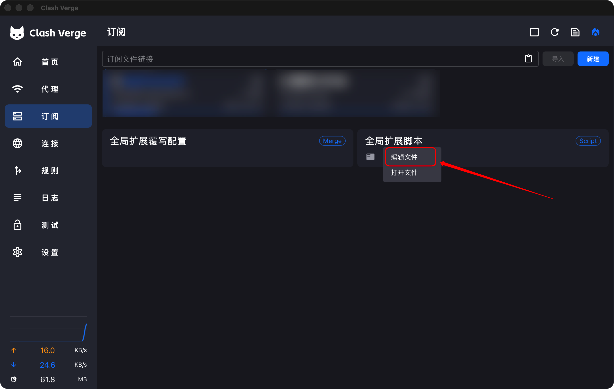
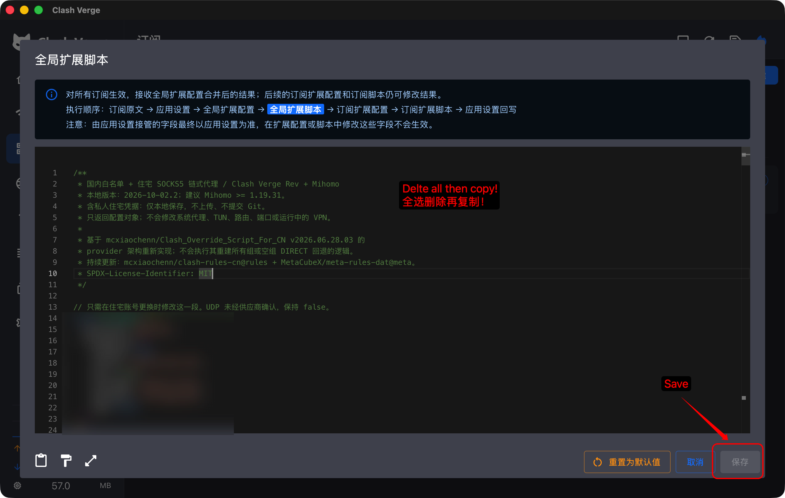
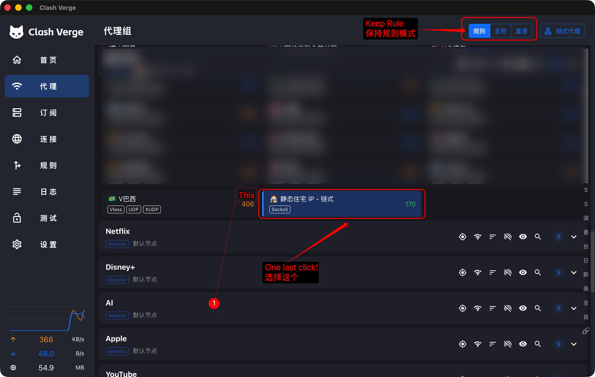

# Clash Once

### Configure once. Less to manage.

[中文](README.md) · **English**

Proxy chaining, automatic entry selection, and routing for China and the rest of the world—all in one script. Copy, paste, enter your exit details, and keep Rule mode on. Spend less time managing your everyday connection.

*配一次，少操心。*

[Get the script](clash-chain.js) · [Download the release](https://github.com/ruihaomei/clash-once/releases/latest) · [Get started](#get-started-in-three-steps)

For **Clash Verge Rev + Mihomo**. Select the residential chain in the main group after the first setup; automatic entry selection and routing rules handle everyday traffic from there.

## What it solves

| Friction | What the script provides |
| --- | --- |
| Building proxy chains and groups by hand | A SOCKS5 exit connected through `dialer-proxy` |
| Repeatedly picking an entry node | Automatic `url-test` selection, every 300 seconds when active, with 50 ms tolerance |
| Toggling the proxy for domestic apps | Mainland China domain/IP and selected-process direct rules; remaining traffic uses the main group |
| Reapplying changes after subscription updates | A global extension script reapplied to subscription configurations |

**Proxied path: device → automatically selected entry → SOCKS5 exit → destination.** Direct traffic bypasses this chain.

## Get started in three steps

Requirements: a working upstream subscription and a username/password SOCKS5 exit; Mihomo ≥ 1.19.31 recommended. No proxy service is included. The main path supports regular `proxies` or auditable `inline` providers; HTTP/file-only provider paths are rejected.

### ① Open the script editor

Back up your current script/config. In Clash Verge Rev, go to **Subscriptions → Global Extension Script → Edit File** (`订阅 → 全局扩展脚本 → 编辑文件`). Labels may vary by version.



### ② Paste the script, enter your exit details, and save

Select all existing content in the editor and replace it with the complete [clash-chain.js](clash-chain.js). **Fill in the four fields at the top: server, port, username, and password**, then click **Save** (`保存`).

```js
server: "__RESIDENTIAL_SERVER__",     // Provider hostname/IP; no socks5:// prefix
port: 0,                              // Provider port; number, no quotes
username: "__RESIDENTIAL_USERNAME__", // Provider username
password: "__RESIDENTIAL_PASSWORD__", // Provider password
```



### ③ Keep Rule mode on and select the residential chain

Open **Proxies** (`代理`) and keep **Rule mode** (`规则`) on. In the selected main group (usually `默认节点`), **select `🏠 静态住宅 IP - 链式` once** to finish setup.

`🔗 前置节点 (自动优选)` manages the entry. Selecting an ordinary node or the entry group bypasses the residential exit.



> The screenshots show where to click, with private details obscured. Use the script from this repository and enter your own exit details.

Verify the exit IP using a site that matches a proxy rule, then check its connection chain. Keep Rule mode on after verification. Enable system proxy/TUN separately as needed: the script does not enable interception, and traffic outside Clash is unaffected.

## Features and limits

- Built-in overseas/AI domain safety rules plus periodically updated remote routing lists. Selected Windows domestic apps and Mac WeChat have process direct rules, subject to process detection. Order: custom direct domains → local networks → overseas/AI proxy → domestic processes/domains/IPs → remaining traffic proxy.
- Reference validation, cycle checks and cleanup of previous residential entries. Removes `DIRECT/PASS/COMPATIBLE` from the main proxy path rather than deliberately falling back to direct access. This is not a comprehensive leak-prevention guarantee.
- **Replaces subscription `rules` and adjusts groups.** Leaves DNS, TUN, system proxy switches and listening ports to existing settings. Later subscription extensions or client overrides may affect the effective configuration; inspect it.
- **Entry health checks measure the entry-to-test-URL path**, not entry-to-exit connectivity, exit health or destination reachability. This is not seamless end-to-end failover. Switching entries may break existing connections; exit failures still need attention.
- `udp: false` by default; UDP through that exit may be rejected. Remote lists, test URLs, DNS and process detection depend on your environment.

Optional: `enabled: false` uses upstream proxies only. `customDirectDomains: ["example.org"]` gives that domain and its subdomains top-priority direct access. `mainGroup` usually needs no change. Custom direct domains override overseas/AI rules; add only intentional exceptions.

## Troubleshooting

**Placeholder/port error?** Fill in all four fields. Port must be an integer from 1 to 65535. Escape double quotes/backslashes in JavaScript strings.

**Unexpected exit IP?** Check the selected main-group option, direct-rule matches and whether the app uses system proxy/TUN.

**Healthy entry but broken chain?** Entry tests do not verify the SOCKS5 exit. Check credentials, provider restrictions and entry-to-exit connectivity; manually test another entry if needed.

**Slow WeChat?** Inspect process, matched rule and outbound chain. Direct routing does not guarantee fast DNS/network access; the script leaves DNS unchanged.

## Privacy, tests and credits

This repository contains placeholders only. Keep filled-in scripts, subscription URLs, logs and effective configurations private. Redact issue reports. `.gitignore` does not prevent secrets added to tracked files.

Run `node --test tests/script.test.cjs` for configuration-generation tests. They do not validate a live end-to-end network path.

MIT; upstream notices retained. Reimplements the provider architecture of [mcxiaochenn/Clash_Override_Script_For_CN](https://github.com/mcxiaochenn/Clash_Override_Script_For_CN). Remote rules are maintained by [clash-rules-cn](https://github.com/mcxiaochenn/clash-rules-cn) and [meta-rules-dat](https://github.com/MetaCubeX/meta-rules-dat), under their respective terms. Public source attribution is retained.

Official references: [Extension scripts](https://www.clashverge.dev/guide/script.html) · [URL tests](https://wiki.metacubex.one/en/config/proxy-groups/url-test/) · [dialer-proxy](https://wiki.metacubex.one/config/proxies/dialer-proxy/)
