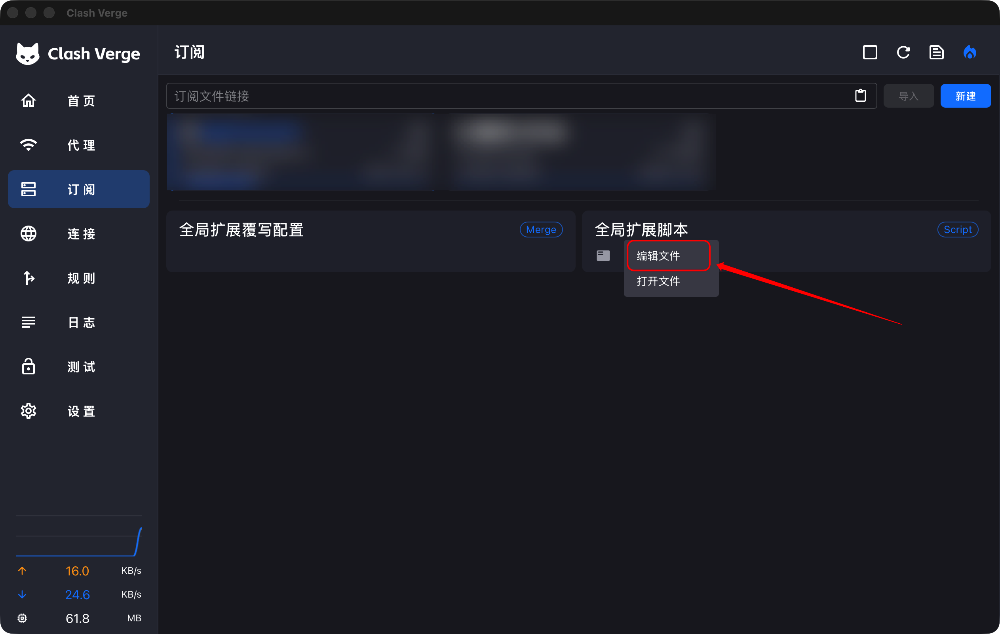
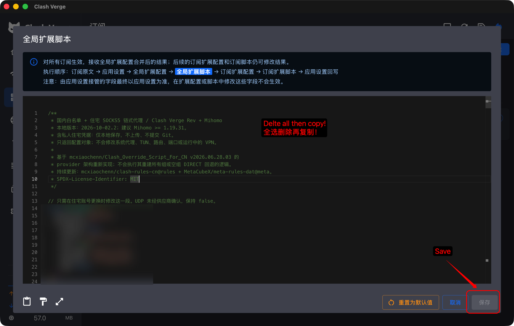
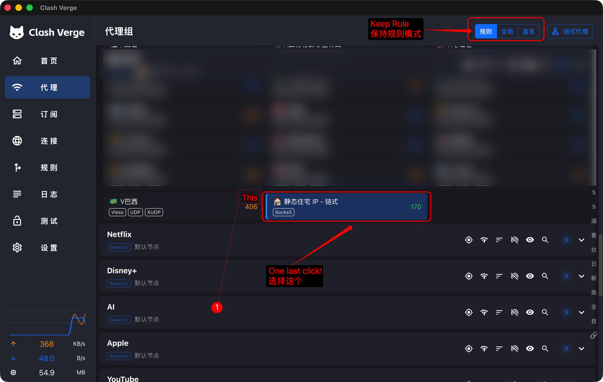

# Clash Once

### 配一次，少操心。

**中文** · [English](README.en.md)

链式代理、自动入口优选、国内外分流，一段脚本配齐。复制粘贴，填入出口信息，保持规则模式，日常少一点折腾。

*Configure once. Less to manage.*

[获取脚本](clash-chain.js) · [下载发布包](https://github.com/ruihaomei/clash-once/releases/latest) · [三步上手](#三步上手)

适用于 **Clash Verge Rev + Mihomo**。首次应用后，在主选择组中选中住宅链式出口；此后由自动入口优选与分流规则处理日常流量。

## 为什么用它？

| 常见麻烦 | 这段脚本做什么 |
| --- | --- |
| 手动搭链、反复配置代理组 | 自动创建 SOCKS5 出口与 `dialer-proxy` 链路 |
| 入口状态变化，需要手动挑选 | `url-test` 每 300 秒按需检测入口，自动优选，切换容差 50 ms |
| 国内外应用来回开关代理 | 国内域名/IP及指定进程直连，其他流量交给主代理组 |
| 订阅更新后重复修改 | 通过全局扩展脚本重新应用到订阅配置 |

**代理链路：本机 → 自动优选入口 → SOCKS5 出口 → 目标服务。** 国内直连流量不经过这条链。

## 三步上手

前提：已有可用订阅入口 + 带账号密码的 SOCKS5 出口；建议 Mihomo ≥ 1.19.31。脚本不会提供任何代理服务。主要路径支持普通 `proxies` 或可审计的 `inline` providers；不支持仅有 HTTP/file providers 的主要路径。

### ① 打开脚本编辑器

先备份旧脚本与配置。在 Clash Verge Rev「订阅 → 全局扩展脚本」中，点击「编辑文件」。不同版本入口名称可能略有不同。



### ② 粘贴脚本，填写出口信息并保存

全选替换编辑器原有内容，粘贴 [clash-chain.js](clash-chain.js) 的完整代码。**只需填写顶部四项：地址、端口、账号、密码**，然后点击「保存」。

```js
server: "__RESIDENTIAL_SERVER__",     // 换成服务商地址，不带 socks5://
port: 0,                              // 换成服务商端口，不加引号
username: "__RESIDENTIAL_USERNAME__", // 换成账号
password: "__RESIDENTIAL_PASSWORD__", // 换成密码
```



### ③ 保持规则模式，选中住宅链式出口

进入「代理」，保持**规则模式**；在脚本选中的主选择组（通常为「默认节点」）中，**首次手动选择「🏠 静态住宅 IP - 链式」**，完成设置。

入口由「🔗 前置节点 (自动优选)」管理。若选择普通节点或前置组，流量不会经过住宅出口。



> 图片为操作位置示意，已做隐私遮挡；代码内容请以本仓库脚本为准，出口信息填写你自己的。

用应走代理的网站检查出口 IP，再检查连接列表的实际代理链；验证后即可保持规则模式日常使用。系统代理/TUN 是否启用由你自行决定，脚本不会替你开启；未被 Clash 接管的流量不受这些规则控制。

## 亮点与边界

- 内置常用海外/AI域名兜底，配合在线更新的国内外规则集；Windows 常见国内客户端及 Mac 微信有进程直连规则（依赖内核识别）。规则顺序：自定义直连 → 本地网络 → 海外/AI代理 → 国内进程/域名/IP直连 → 其余代理。
- 保留并校验节点/组引用，清理旧住宅注入、检测循环引用；移除主代理路径的 `DIRECT/PASS/COMPATIBLE`，不主动配置失败后回退直连。此设计不等于完整的网络防泄漏保证。
- 原订阅的 **`rules` 会被替换**；代理组也会调整。DNS、TUN、系统代理开关及监听端口不由脚本配置。订阅扩展或客户端设置可能进一步改变最终配置，请检查实际生效配置。
- **自动优选只检测入口到测试网址的可用性与延迟**，不检测入口到 SOCKS5 出口、出口本身或目标服务的整链健康，也不是无缝故障转移；更换入口可能中断现有连接。出口故障仍需处理，不能保证“永不断线”。
- 默认 `udp: false`；经该出口的 UDP 业务可能被拒绝。在线规则、测试网址、DNS和进程识别均依赖实际环境。

可选设置：`enabled: false` 仅用订阅入口；`customDirectDomains: ["example.org"]` 将该域名及子域名优先直连；`mainGroup` 通常不用改。自定义直连优先于海外/AI规则，请仅添加确实需要绕过代理的域名。

## 常见问题

**保存报占位符/端口错误？** 四项信息必须填写完整；端口为 1–65535 的整数。文本中的双引号和反斜线需转义。

**出口 IP 没变？** 检查主组是否选中住宅链式出口、流量是否命中国内直连规则，以及应用是否经过系统代理/TUN。

**入口测速正常，链路仍不通？** 入口测速不代表能连接住宅出口。检查出口账号、服务商限制和入口到出口的连通性，必要时手动测试其他入口。

**微信依然慢？** 在连接详情核对进程、命中规则、出站链；直连不保证 DNS 或网络无延迟。本项目不修改 DNS 来掩盖问题。

## 隐私、验证与致谢

本仓库仅含占位符；填写后的脚本、订阅URL、运行日志和生效配置请留在本地，提 Issue 前先脱敏。`.gitignore` 只是辅助，无法阻止把密码写进已跟踪文件。

运行 `node --test tests/script.test.cjs` 检查配置生成与防错逻辑；这些测试不代表真实网络端到端验证。

MIT，保留上游版权声明。基于 [mcxiaochenn/Clash_Override_Script_For_CN](https://github.com/mcxiaochenn/Clash_Override_Script_For_CN) 的 provider 架构重实现；在线规则来自 [clash-rules-cn](https://github.com/mcxiaochenn/clash-rules-cn) 和 [meta-rules-dat](https://github.com/MetaCubeX/meta-rules-dat)，其内容与许可由各项目维护。公共来源与作者归属不作个人隐私删除。

官方参考：[扩展脚本](https://www.clashverge.dev/guide/script.html) · [自动优选](https://wiki.metacubex.one/config/proxy-groups/url-test/) · [dialer-proxy](https://wiki.metacubex.one/config/proxies/dialer-proxy/)
